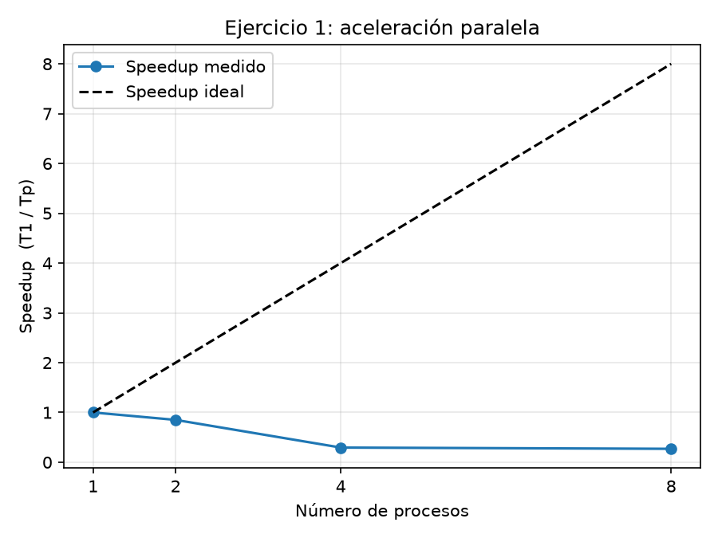
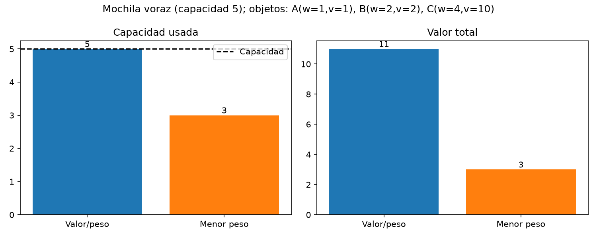
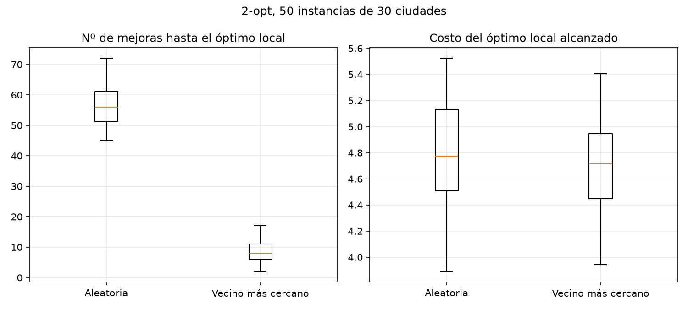
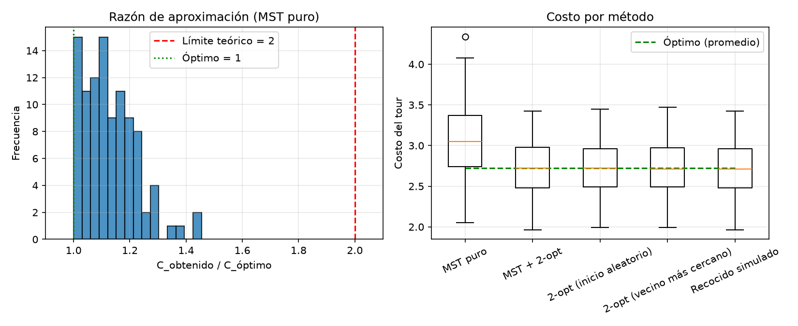

## Ejercicios
Rebeca Moreno González

### Ejercicio 1: ¿Por qué la aceleración no es perfectamente lineal?

El speedup baja al usar más procesos porque crearlos y coordinarlos también consume tiempo. Además, hay comunicación entre ellos, partes del programa que siguen siendo secuenciales y límites del hardware.

En conclusión, el paralelismo no siempre mejora el rendimiento, especialmente cuando el trabajo es pequeño y los costos de ejecutarlo en paralelo son mayores.

### Ejercicio 2

### Ejercicio 3: ¿El Vecino Más Cercano requiere menos mejoras que el inicio aleatorio?

Sí, el Vecino Más Cercano necesita muchas menos mejoras: aproximadamente 8, frente a 56 del inicio aleatorio. Sin embargo, la calidad final de ambos es muy parecida.

Esto pasa porque el Vecino Más Cercano genera una ruta inicial más ordenada, por lo que 2-opt necesita hacer menos cambios. Su principal ventaja es que llega al resultado más rápido.

### Ejercicio 4: ¿Cómo impacta cada esquema de enfriamiento en la calidad y el tiempo?

El esquema exponencial obtuvo el mejor costo promedio, seguido del lineal y el inverso, aunque las diferencias fueron pequeñas. Los tres tardaron casi lo mismo porque utilizaron el mismo número de iteraciones.

El inverso converge más rápido, pero puede explorar menos; el exponencial equilibra mejor la exploración y el refinamiento, mientras que el lineal tarda más en bajar la temperatura.

En general, el esquema de enfriamiento influye más en la calidad del resultado que en el tiempo de ejecución.

### Ejercicio 5

**¿Qué tan cerca se mantiene la razón observada del límite teórico de 2?**

La razón observada se mantiene bastante lejos de 2, ya que la mayoría de los resultados están entre 1.0 y 1.3. Esto se debe a que el límite de 2 representa el peor caso y es difícil alcanzarlo con instancias aleatorias pequeñas.

**¿Qué impacto tiene aplicar 2-opt al MST?**

Aplicar 2-opt mejora bastante el resultado, reduciendo el costo de aproximadamente 3.05 a 2.72. Además, su resultado final es muy parecido al de los otros métodos probados.

Esto demuestra que el MST es un buen punto de partida, pero aplicar 2-opt ayuda a mejorar la ruta. También confirma que el punto inicial influye más en la cantidad de mejoras necesarias que en la calidad final.
